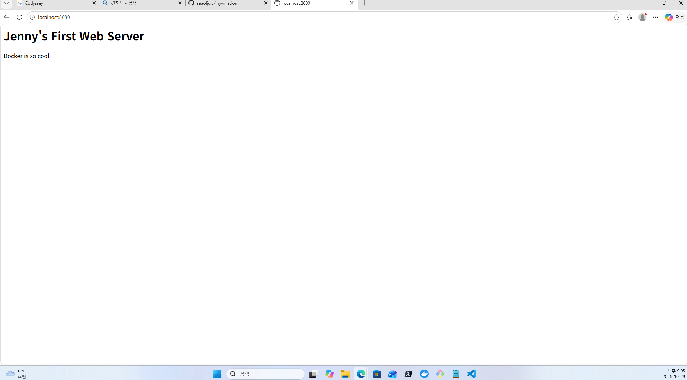
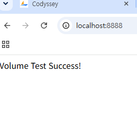
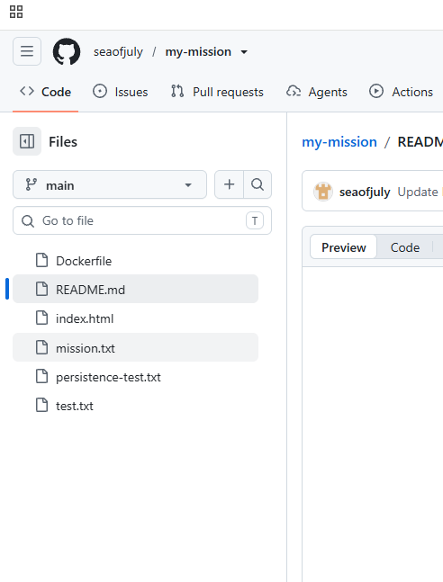

# 🚀 개발 워크스테이션 구축 미션 결과 보고서

## 1. 프로젝트 개요
터미널 환경 설정, Docker 컨테이너 관리, Git/GitHub 버전 관리를 통해 재현 가능한 개발 환경을 구축하고 문서화하는 것을 목표로 합니다.

## 2. 실행 환경
- **OS:** Windows 11 
- **Shell/Terminal:** Git Bash
- **Docker Version:** Docker version 29.9.2, build a82e528
- **Git Version:** git version 2.56.0.windows.4

## 3. 수행 항목 체크리스트
- [x] 터미널 조작 및 권한 설정 실습
- [x] Docker 설치 및 기본 점검 (version, info)
- [x] Docker 기본 운영 명령 수행 (images, ps, logs, stats)
- [x] 컨테이너 실행 실습 (hello-world, ubuntu)
- [x] Dockerfile 기반 커스텀 이미지 제작 (Nginx)
- [x] 포트 매핑 및 브라우저 접속 확인
- [x] Docker 볼륨을 이용한 데이터 영속성 검증
- [x] Git 사용자 설정 및 GitHub 저장소 연동

---

## 4. 터미널 조작 및 권한 실습 로그

### 4.1 기본 명령어 수행
```bash

# 현재 위치 확인
$ pwd
/c/Users/User/my-mission

# 목록 확인 (숨김 파일 포함)
$ ls -al
total 4
drwxr-xr-x 1 User 197121 0 Oct 31 10:45 .
drwxr-xr-x 1 User 197121 0 Oct 31 10:40 ..
-rw-r--r-- 1 User 197121 50 Oct 31 10:42 README.md

# 디렉토리 생성 및 이동
$ mkdir test_dir
$ cd test_dir

# 빈 파일 생성 및 내용 확인
$ echo "Hello Terminal" > mission.txt
$ cat mission.txt
Hello Terminal

# 복사, 이름 변경, 삭제
$ cp mission.txt mission_copy.txt
$ mv mission_copy.txt renamed_mission.txt
$ rm renamed_mission.txt
```

### 4.2 권한 실습 (chmod)
```bash
# 파일 권한 변경 전
$ ls -l mission.txt
-rw-r--r-- 1 User 197121 15 Oct 31 10:46 mission.txt

# 권한 변경 실행
$ chmod 755 mission.txt

# 파일 권한 변경 후 (x가 추가된 것을 확인)
$ ls -l mission.txt
-rwxr-xr-x 1 User 197121 15 Oct 31 10:46 mission.txt

# 디렉토리 권한 변경 전
$ ls -ld test_dir
drwxr-xr-x 1 User 197121 0 Oct 31 10:45 test_dir

# 디렉토리 권한 변경 실행 (소유자만 읽고 쓰기 가능)
$ chmod 700 test_dir

# 디렉토리 권한 변경 후 (drwx------ 확인)
$ ls -ld test_dir
drwx------ 1 User 197121 0 Oct 31 10:45 test_dir
```
---

## 5. Docker 실습 결과

### 5.1 Docker 설치 및 실행 확인
- **Docker 버전 확인**
```bash
  $ docker --version
  Docker version 29.9.2, build a82e528       
```
### 5.2 기본 운영 명령

1 **이미지 목록 확인 (`docker images`)**
```bash
IMAGE                  ID             DISK USAGE   CONTENT SIZE   EXTRA
hello-world:latest     c567b231f656       25.9kB         9.49kB    U   
my-web-server:latest   da33294fd7a8        241MB         63.9MB        
nginx:latest           600f7cd45e27        243MB         66.8MB    U   
```

2 **컨테이너 목록 확인 (docker ps -a)**
```bash
CONTAINER ID   IMAGE         COMMAND                   CREATED          STATUS                      PORTS                  NAMES
0fe926a12ed0   hello-world   "/hello"                  10 minutes ago   Exited (0) 9 minutes ago                           jolly_wilson
feb2ffb8a849   hello-world   "/hello"                  13 minutes ago   Exited (0) 13 minutes ago                          mystifying_cohen
1c2c2f9fd41b   nginx         "/docker-entrypoint.…"   38 hours ago     Exited (255) 22 hours ago   0.0.0.0:8080->80/tcp   web-mission-check
```

3 **컨테이너 로그 확인 (docker logs 0fe9)**
```bash
Share images, automate workflows, and more with a free Docker ID:
 https://hub.docker.com/

For more examples and ideas, visit:
 https://docs.docker.com/get-started/
```
---

4 **리소스 사용량 확인 (docker stats --no-stream)**
```bash
CONTAINER ID   NAME              CPU %     MEM USAGE / LIMIT    MEM %     NET I/O        BLOCK I/O   PIDS
a6da93a2c848   recursing_black   0.00%     1.32MiB / 7.619GiB   0.02%     1.7kB / 126B   0B / 0B     1
```


## 6. 컨테이너 실행 실습

### 6.1 hello-world & ubuntu
- `hello-world` 실행 성공 확인
- `ubuntu` 컨테이너 진입 및 명령 수행:
```bash
$ docker run -it ubuntu bash
# 내부에서 ls, echo 수행 후 exit
```

6.2 attach vs exec 차이점 정리
attach: 실행 중인 컨테이너의 표준 입력/출력에 연결합니다. 종료 시 컨테이너가 멈출 수 있습니다.
exec: 실행 중인 컨테이너에 새로운 프로세스를 실행합니다. 테스트나 디버깅 시 안전하게 사용 가능합니다.

6.3 나만의 웹 서버 빌드 및 실행 (추가)
Dockerfile 작성 및 이미지 빌드
```bash
# Dockerfile을 이용해 my-web-server 이미지 생성
$ docker build -t my-web-server .
```
포트 포워딩을 이용한 컨테이너 실행
```bash
# 8080 포트로 접속하면 컨테이너의 80 포트로 연결되도록 실행
$ docker run -d -p 8080:80 --name web-mission my-web-server
```
실행 상태 확인 (docker ps)
```bash
CONTAINER ID   IMAGE           COMMAND                   CREATED          STATUS          PORTS                                     NAMES
d555583ae5bc   my-web-server   "/docker-entrypoint.…"   57 seconds ago   Up 57 seconds   0.0.0.0:8080->80/tcp, [::]:8080->80/tcp   web-mission
```


---

## 7. 커스텀 이미지 제작 (Nginx)

- **베이스 이미지:** `nginx:latest`
- **커스텀 포인트:** 기본 `index.html` 파일을 로컬의 커스텀 파일로 교체하여 "Jenny's First Web Server" 메시지 출력.
- **빌드 및 실행 명령:**
```bash
# 이미지 빌드
$ docker build -t my-web-server .

# 컨테이너 실행 (8080 포트 연결)
$ docker run -d -p 8080:80 --name my-container my-web-server
```
- **접속 증거:**  브라우저 localhost:8080 접속 시 커스텀 메시지 확인 완료.

[결과 화면 스크린샷]


---

## 8. Docker 볼륨 영속성 검증
1. **볼륨 생성:** `docker volume create my-data`
2. **연결 및 파일 생성:** 컨테이너 내 `/usr/share/nginx/html`에 마운트 후 `index.html` 생성.
3. **삭제 후 재연결:** 컨테이너 삭제 후 새 컨테이너(`vol-test-new`) 연결 시 파일 유지 확인.

```bash
# 검증 로그 (docker volume inspect my-data)
[
    {
        "CreatedAt": "2024-05-22T...", 
        "Driver": "local",
        "Labels": null,
        "Mountpoint": "/var/lib/docker/volumes/my-data/_data",
        "Name": "my-data",
        "Options": null,
        "Scope": "local"
    }
]
```
 
---

## 9. Git 및 GitHub 연동

### 9.1 Git 설정 확인
```bash
user.name=Jenny
user.email=*******@gmail.com  # 개인정보 보호를 위해 마스킹 처리함
init.defaultbranch=master
remote.origin.url=https://github.com/seaofjuly/docker-practice.git
```

### 9.2 GitHub 연동 증거
- 저장소 URL: [https://github.com/seaofjuly/docker-practice](https://github.com/seaofjuly/docker-practice)
- 

